# DBGold：项目介绍与快速上手

DBGold 是一款集迁移执行、过程查看与结果核对于一体的数据库迁移平台，帮助团队更从容地完成数据库替换、国产化迁移与测试环境复制。通过直观的操作界面、清晰的过程反馈和可追溯的迁移报告，让每一步操作有章可循，让迁移结果有据可查。

本指南面向首次使用的用户，从 Windows、Linux 和 macOS 的解压启动开始，介绍 **MySQL → PostgreSQL 内核系列**和 **MySQL → 达梦**两个场景。准备好连接信息后，即可按图完成配置与结果核对。点击图片可查看原图。

## 1. DBGold 的主要价值

- **多库适配：** 覆盖 PostgreSQL 内核系列、达梦等常见迁移方向，可选择整个库或部分表。
- **操作直观：** 通过页面完成连接配置、范围选择和任务启动，无需先编写迁移脚本。
- **结果可核对：** 查看失败明细、比较记录数量，并按需校验数据内容。
- **部署轻便：** Windows、Linux、macOS 均可使用 portable 单目录包，解压后即可启动。

需要同时处理多个任务时，可使用 Excel 模板进行批量迁移；需要持续同步后续数据变化时，可使用支持对应组合的增量迁移；需要协作处理时，可通过工单管理提交需求并跟踪进展。本指南聚焦单次迁移。

### 当前支持的迁移方向

单次迁移用于完成一次数据搬迁；增量迁移用于持续同步后续数据变化。可按源数据库查找支持的目标，再选择适合自己的迁移方式。

| 源数据库 | 单次迁移目标 | 增量迁移目标 |
|---|---|---|
| MySQL | PostgreSQL 内核系列、达梦、Oracle、SQL Server、MySQL、神通 | PostgreSQL 内核系列、达梦 |
| Oracle | PostgreSQL 内核系列、达梦、SQL Server、MySQL、神通 | 暂不支持 |
| SQL Server | PostgreSQL 内核系列、达梦、Oracle、MySQL、神通 | 暂不支持 |
| 达梦 | PostgreSQL 内核系列、Oracle、SQL Server、MySQL、达梦、神通 | 暂不支持 |
| PostgreSQL 内核系列 | MySQL、Oracle、SQL Server、达梦 | 暂不支持 |
| 神通（Oscar） | MySQL | 暂不支持 |

- **系列范围：** PostgreSQL 内核系列包括 PostgreSQL、GaussDB、SeaBox、HighGo（瀚高）、Vastbase（海量数据库）、GBase（PG 兼容）、Kingbase（人大金仓）。
- **适用范围：** 具体可迁移对象以页面选项为准。使用增量迁移前，进入 **迁移生成 → 增量迁移**，点击 **运行预检**，按提示完成设置和权限准备，预检通过后再启动任务。
- **达梦同库迁移：** 达梦 → 达梦要求两端为相同版本的 DM8，迁移整个 Schema 的全部对象及数据，不能选择同一实例中的同一 Schema。

## 2. 解压并启动

### Windows：解压后双击启动

**① 解压。** 获取 `dbgold-v1.2.9-portable-windows-amd64.zip`，完整解压到自己能读写的文件夹，打开里面的 `dbgold` 文件夹。这里以 v1.2.9 为例，版本号以你拿到的包为准。

**② 双击 `start.cmd`。** 不要在压缩包里直接运行，也不要只把主程序单独拖出来。解压后的文件夹需要完整保留。

<a href="images/getting-started/01-windows-files.png">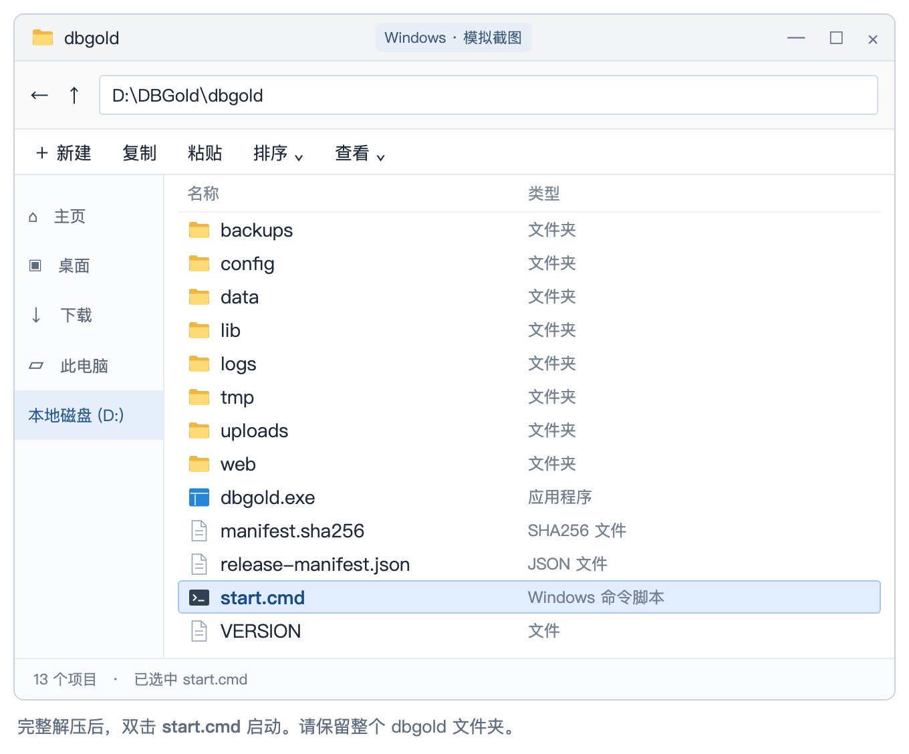</a>

*解压后完整保留文件夹，双击 start.cmd 启动。*

**③ 记下密码，等待就绪。** 首次启动会显示管理员 `admin` 的初始密码。看到“dbgold 已就绪”后，浏览器会自动打开。请保持启动窗口打开。

<a href="images/getting-started/02-windows-start.png">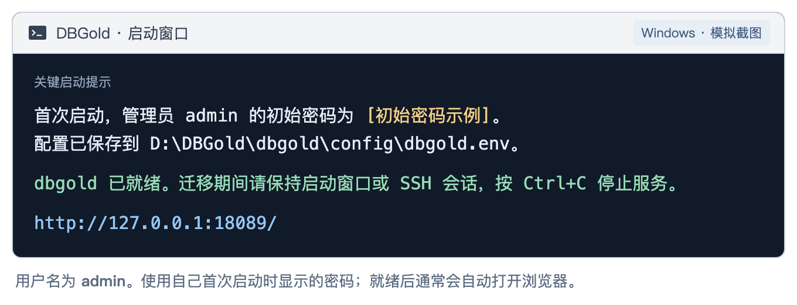</a>

*等待“已就绪”，使用自己启动窗口中显示的初始密码。*

**④ 登录。** 如果浏览器没有自动打开，手动访问窗口中的地址，默认是 `http://127.0.0.1:18089/`。输入 `admin` 和初始密码即可。

### Linux：解压后在终端启动

**① 选择对应的包。** 在服务器终端输入 `uname -m`：显示 `x86_64` 时选 `linux-amd64`，显示 `aarch64` 时选 `linux-arm64`。把压缩包放到当前账号可读写的目录。

**② 解压并启动。** 以下配图和命令以 v1.2.9、arm64 包为例；请替换成实际文件名，x86_64 机器使用 amd64 包。

```sh
tar -xzf dbgold-v1.2.9-portable-linux-arm64.tar.gz
cd dbgold
./start.sh
```

**③ 记下密码和地址。** 等待“dbgold 已就绪”，保存首次显示的管理员密码。Linux 会打印访问地址，不会自动打开浏览器。

<a href="images/getting-started/03-linux-start.png">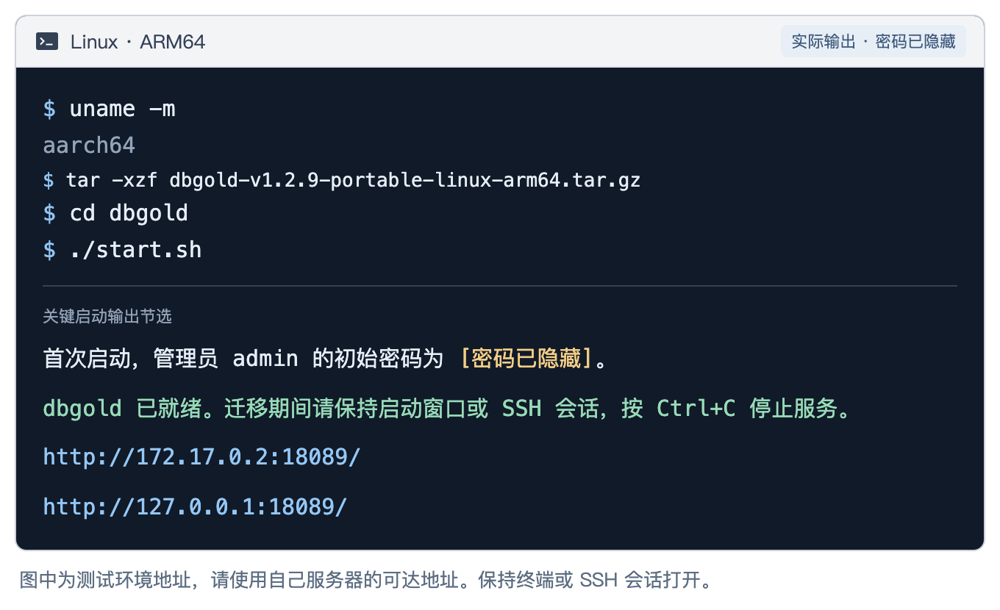</a>

*记录初始密码，并使用自己服务器的访问地址。*

**④ 在办公电脑登录。** 在浏览器打开终端列出的服务器内网地址，例如 `http://192.168.10.20:18089/`，使用 `admin` 和初始密码登录。请勿把服务器输出中的 `127.0.0.1` 当作办公电脑访问地址；它表示当前电脑自己。

### macOS：解压后在终端启动

**① 选择对应的包。** 打开苹果菜单中的「关于本机」。显示 Apple 芯片时选 `darwin-arm64`，显示 Intel 处理器时选 `darwin-amd64`。需要 macOS 12 或更新版本。

**② 完整解压。** 以下配图使用 Intel 架构的 `v1.2.10-dev` 开发包，版本和架构请按实际替换。在压缩包所在目录打开终端执行：

```sh
tar -xzf dbgold-v1.2.10-dev-portable-darwin-amd64.tar.gz
```

请完整保留解压后的 `dbgold` 文件夹，不要单独移动主程序。

<a href="images/getting-started/12-macos-files.png">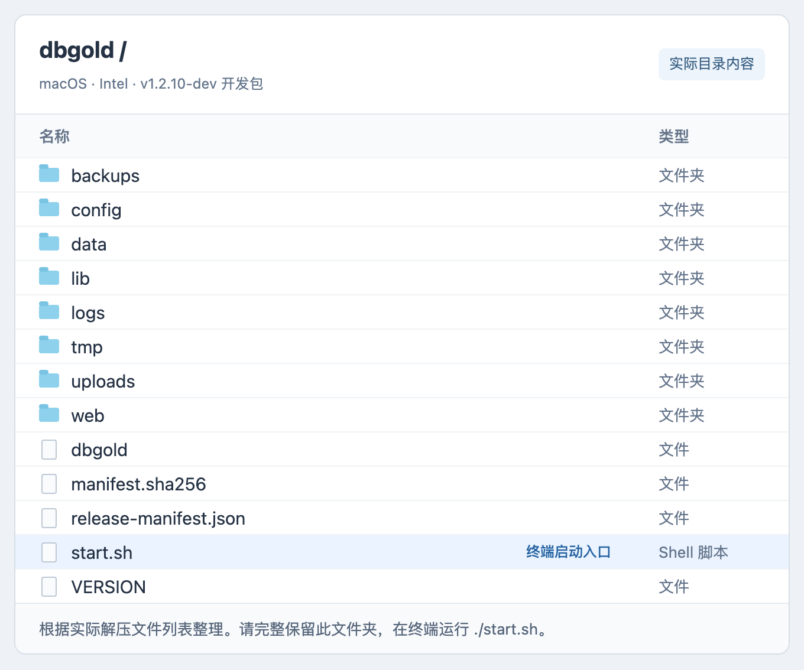</a>

*实际解压目录的文件列表；确认 start.sh 与其他文件完整保留。*

**③ 在终端启动。** 接着执行以下命令，等待“dbgold 已就绪”，记录首次显示的管理员 `admin` 初始密码，并保持终端打开。

```sh
cd dbgold
./start.sh
```

<a href="images/getting-started/13-macos-start.png">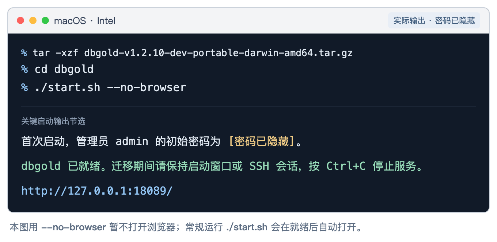</a>

*服务就绪后保留终端窗口，在浏览器继续操作。*

**④ 登录。** 服务就绪后会自动打开默认浏览器；若未打开，手动访问终端显示的地址，默认是 `http://127.0.0.1:18089/`。输入 `admin` 和初始密码登录。使用 `./start.sh --no-browser` 可关闭自动打开浏览器的功能。

<a href="images/getting-started/04-login.png">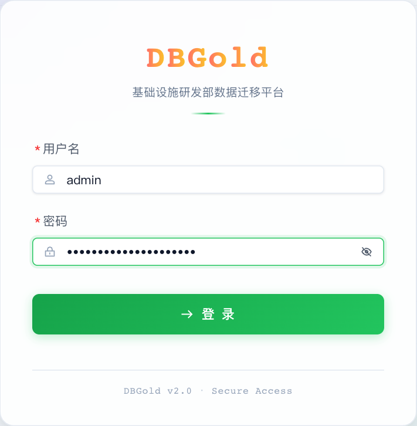</a>

*使用初始账号登录，随后进入“连接管理”。*

这两个迁移场景无需额外安装 Go、Node.js 或 Java。迁移期间请保持启动窗口或 SSH 会话打开；关闭浏览器不会停止迁移。全部任务结束后，可在启动窗口按 **Ctrl+C** 停止服务。

## 3. 迁移前，先准备两端连接

“源库”是需要迁出数据的数据库，“目标库”是接收数据的数据库。请向管理员获取两端的地址、端口、数据库名、用户名和密码，并确认目标数据库已经准备好。

在 **连接管理 → 新建连接** 中填写信息，给连接起容易区分的名称，例如“MySQL-演示源库”。保存后，在列表点击 **测试**。源库和目标库都测试成功，再继续迁移。

<a href="images/getting-started/05-new-connection.png">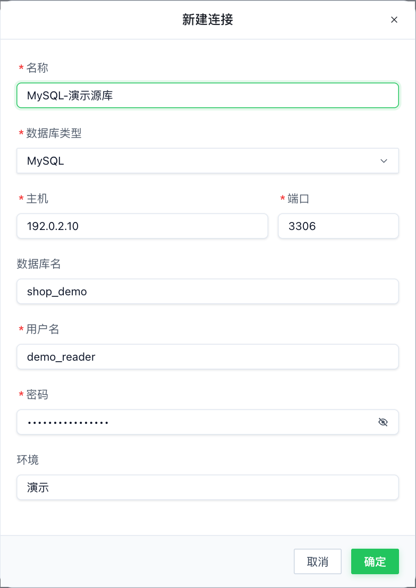</a>

*保存连接后，回到连接列表点击“测试”；端口按实际配置填写。*

| 连接类型 | 填写时注意 |
|---|---|
| MySQL | 填写需要迁移的数据库名，例如 `shop_demo`；常用端口为 3306 |
| PostgreSQL 内核系列 | 类型选实际产品，填写已存在的目标数据库；PostgreSQL 常用端口为 5432，其他产品以实际为准 |
| DaMeng（达梦） | 常用端口为 5236；“数据库名”可以留空，后续在迁移页选择业务 Schema |

**Schema 可以理解为目标库里存放表的位置。** 请让管理员提前准备并告诉你该选哪一个，同时确认账号能读取源库、在目标位置创建表和写入数据。

> **开始前请确认：** 首次建议使用测试库或空白目标位置。本文选择“表结构 + 数据行”，会删除重建迁移范围内的目标同名表，原有数据会丢失，请先备份。暂停源库和目标库的相关业务写入，直到迁移与核对结束。

## 4. 场景一：MySQL 迁移到 PostgreSQL 内核系列

适用于页面中的 PostgreSQL、GaussDB、SeaBox、HighGo（瀚高）、Vastbase（海量数据库）、GBase（PG 兼容）、Kingbase（人大金仓）。以下以 PostgreSQL 为例，其他产品按实际类型选择，不要一律选 PostgreSQL。

### 第 1 步：选好来源和目标位置

进入 **迁移生成 → 单次迁移**。左侧选 MySQL 连接，确认“数据库”为 `shop_demo`；右侧选 PostgreSQL 连接，确认目标数据库，并选择 **目标 Schema**，示例为 `public`。

如果修改了“数据库”框中的内容，需要点击 **验证并保存** 才能继续。这里会更新该连接的默认数据库，请先确认没有选错连接。

<a href="images/getting-started/06-pg-target.png">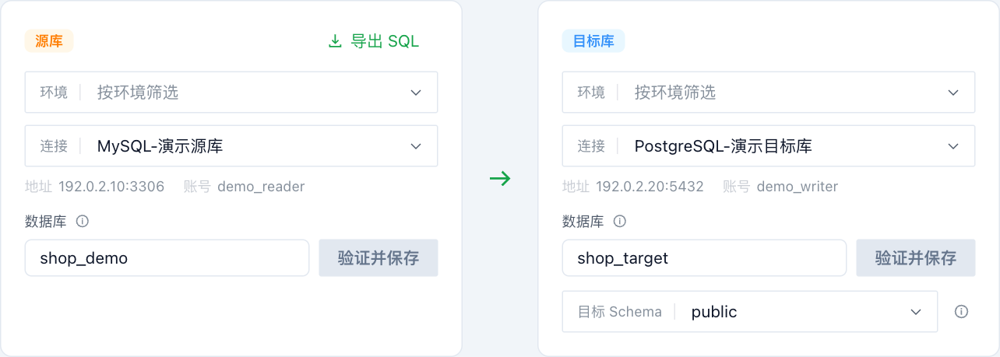</a>

*核对左侧数据来源，以及右侧目标连接、数据库和存放位置。*

### 第 2 步：选择迁移内容

“迁移范围”选择 **全库迁移**，“迁移内容”选择 **表结构 + 数据行**。

展开 **高级设置**，本教程取消勾选 **更改对象 owner 为 Schema 同名角色**，让新建对象归当前连接账号所有。该选项在 PG 系列默认开启，示例使用 `public` 时请务必取消；确需更改归属时再由管理员指导设置。

其余参数先保持默认。想逐项比较两端数据，可勾选 **迁移后校验数据内容**；它会增加耗时，期间也需要保持两端停写。

<a href="images/getting-started/07-pg-options.png">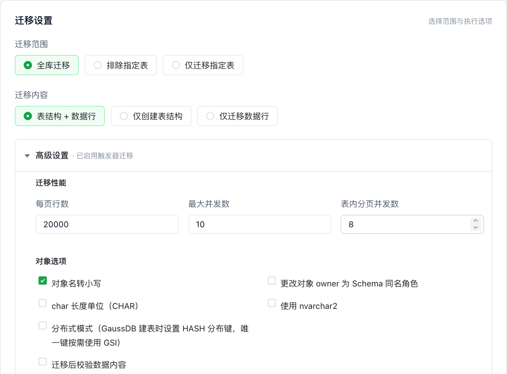</a>

*选择“全库迁移”和“表结构 + 数据行”，并取消图中 owner 选项。*

### 第 3 步：核对后开始

点击 **开始迁移**。在弹窗中再次核对目标连接、数据库、Schema 和迁移范围，确认备份完成后点击 **确认并开始**。系统会检查迁移条件，随后在“执行日志”展示进度。

<a href="images/getting-started/08-confirm.png">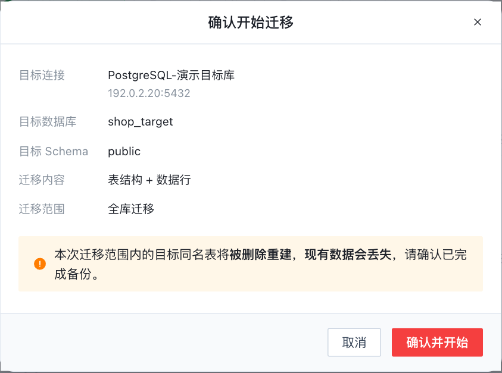</a>

*核对目标位置、迁移范围和删除重建提示后，再确认开始。*

### 第 4 步：查看迁移报告

执行结束后可在 **迁移报告** 查看结果；要留档，进入 **任务中心 → 单次迁移 → 详情**。检查“报告项”下的失败数量、“行数对比”和“数据内容校验”，在“迁移概览”查看各类结果。有失败时打开 **失败对象** 查看原因，点击 **导出报告** 保存。

<a href="images/getting-started/09-pg-report.png">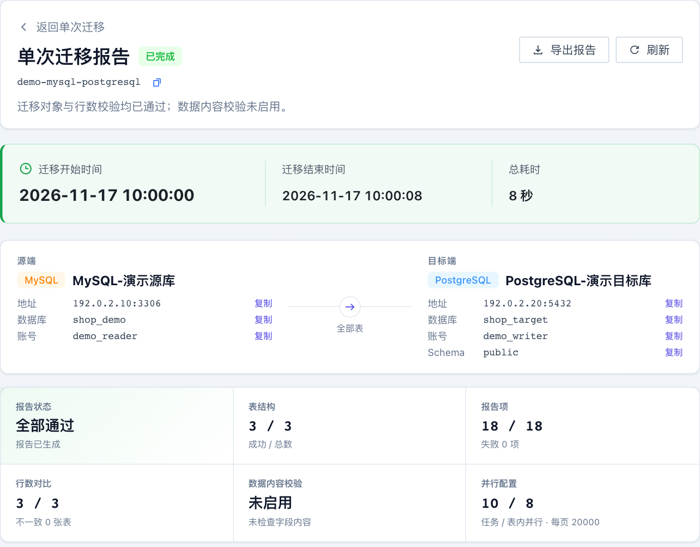</a>

*在任务详情中检查失败数量、行数对比和数据内容校验状态。*

## 5. 场景二：MySQL 迁移到达梦

### 第 1 步：选好 MySQL 和达梦连接

进入 **迁移生成 → 单次迁移**，左侧选 MySQL 连接并确认数据库，右侧选 **DaMeng（达梦）** 连接，再选择管理员准备好的业务 **目标 Schema**，例如 `SHOP_DEMO`。

达梦连接里的“数据库名”可以为空，但这里的目标 Schema 必须选择。下拉框中看不到业务位置时，请先让管理员创建或确认访问权限，不要使用系统管理账号名称代替业务位置。

<a href="images/getting-started/10-dameng-target.png">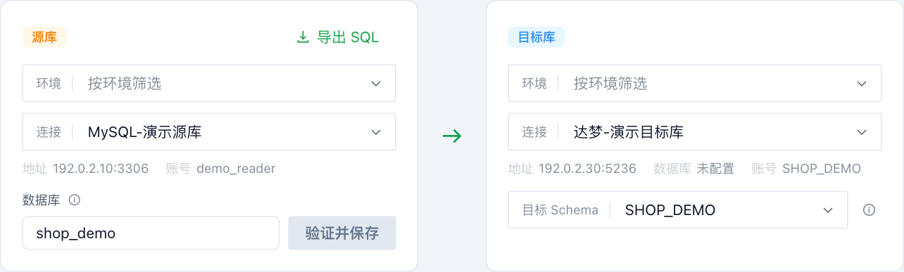</a>

*选择已准备好的业务目标 Schema，确认表和数据的存放位置。*

### 第 2 步：使用完整迁移设置

选择 **全库迁移 + 表结构 + 数据行**。高级设置中的 **达梦普通表写入方式**保持 **批量写入（默认）**，其余参数先不调整。需要比较字段内容时，勾选“迁移后校验数据内容”。

### 第 3 步：确认并开始

点击 **开始迁移**，核对弹窗中的达梦连接和业务 Schema，确认目标同名表可以删除重建，再点 **确认并开始**。迁移期间保持两端停写，在“执行日志”查看进度。

### 第 4 步：核对结果并保存报告

结束后可在 **迁移报告** 看结果；要留档，进入 **任务中心 → 单次迁移 → 详情**。打开 **行数对比**，选择 **全部** 查看各表记录数量，并检查“报告项”的失败数量；启用了内容校验，还要确认其通过。有失败时查看 **失败对象**，导出报告交给管理员处理。

<a href="images/getting-started/11-dameng-report.png">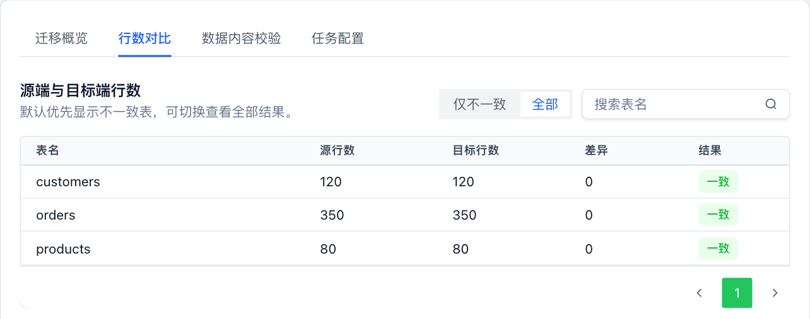</a>

*在“行数对比”中选择“全部”，核对每张表的源行数和目标行数。*

## 6. 迁移后的核对事项

- **行数一致不等于所有内容都检查过。** 默认会比较记录数量；只有启用并完整通过“迁移后校验数据内容”，才表示此次内容比对通过。
- **任务失败时先核对已完成范围。** 某张表失败后，其他不受影响的表仍可能继续迁移。先看报告，避免直接重复执行覆盖已迁移的数据。
- **报告可以以后再看。** 打开 **任务中心 → 单次迁移 → 详情**，查看任务结果并导出报告。
- **特殊功能可能需要人工处理。** 部分触发器可自动迁移，复杂内容仍可能失败；函数和存储过程可通过源库卡片的 **导出 SQL** 保存原文，再请技术人员适配，不能直接当作目标库可用文件。

## 7. 常见问题

| 遇到的情况 | 可以先这样处理 |
|---|---|
| 浏览器没有自动打开 | Windows、macOS 手动打开启动窗口中的地址；Linux 需要手动访问服务器地址 |
| 页面打不开 | 确认窗口显示“已就绪”；Linux 从办公电脑访问时，请管理员检查网络和访问端口 |
| 提示端口已被占用 | 请管理员修改 `config/dbgold.env` 中的 `PORT` 后重启，使用新地址访问；程序不会自动换端口 |
| 重启后没再显示密码 | 初始密码只在首次生成配置时显示；尚未改密时可在自己的配置文件中查看 `ADMIN_PASS`，不要把配置发给他人 |
| 连接测试失败，或目标 Schema 为空 | 核对地址、端口、账号和密码，并请管理员确认数据库、业务 Schema 和权限已经准备好 |
| 无法开始迁移 | 检查两端连接、数据库与目标 Schema 是否填好；数据库有改动时先点击“验证并保存” |

初次登录后，管理员可在 **用户管理 → 重置密码** 中更换密码。更改配置文件里的 `ADMIN_PASS` 不会重置已有账号的登录密码。

## 8. 延伸阅读

macOS 升级前，请确认迁移任务结束并停止 DBGold，将同架构新版解压到另一个目录，再使用新版主程序升级原目录，具体见 [单目录包升级](../README.md#单目录包升级)。其他安装、升级和部署说明请参阅项目 [README](../README.md)。

### 配图说明

Windows 文件夹和启动窗口为模拟截图；macOS 目录图根据实际解压文件列表整理；Linux、macOS 启动画面根据隔离演示环境中的实际输出排版，初始密码已隐藏。网页图片使用项目真实页面与演示数据，报告仅用于说明核对方法，不代表已完成真实数据库迁移。图中地址、库名和账号仅作示例，请替换成实际信息。点击图片可查看原图。
